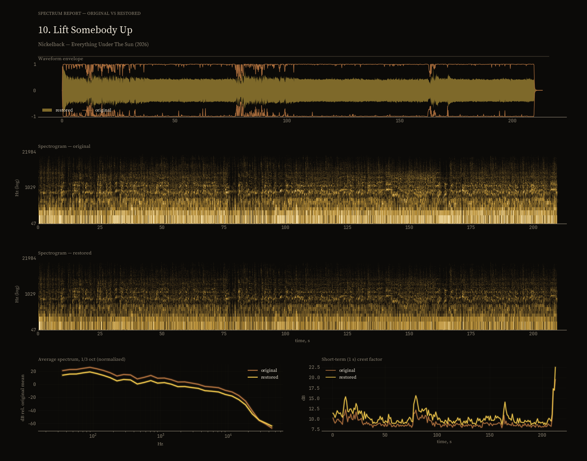
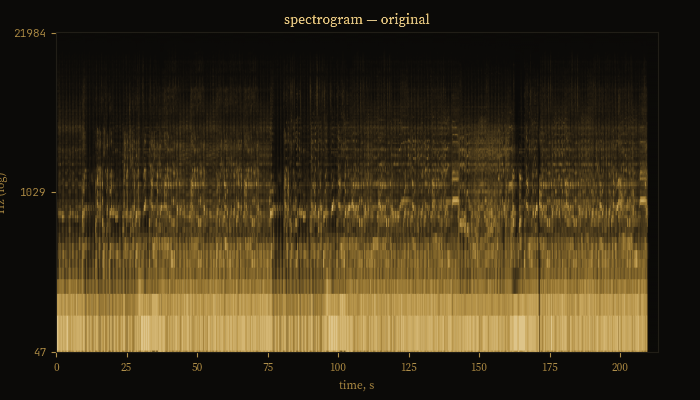

# music-restoration

Say "restore this" to an agent with these skills, and it takes an album the
whole way: finds the best release on the tracker if you don't have the files,
checks them for real lossless, restores every track, runs the quality gates,
tags the result, embeds cover art and lyrics, and puts the album in your
collection with a DR report and spectrum charts.

The restoration is deterministic DSP: a 25 Hz high-pass, declipping when the
master actually clips, per-band dynamics work, and a true-peak ceiling at
−0.5 dBFS. Every track gets its own settings. The agent tries several
restoration policies on it, keeps the one that hits the target, and
re-processes the track if the result lands outside the window. Output is
16/24-bit FLAC in the format of the source.

## What a release looks like

One track from Nickelback's "Everything Under the Sun" (2026, WEB 24/96),
crushed to DR 5 by the master. Original in copper, restored in gold:



The original rides full-scale for most of the song. The restored version keeps
more than twice the crest factor and never touches the ceiling; the spectrogram
gains air above 10 kHz without losing the low end. The GIF flips between the
two spectrograms:



Numbers for this track: DR 5 → 11, true peak +0.4 → −0.5 dBFS, zero added
clipping, duration unchanged. Every release also ships `DR Report.txt` — the
DR-meter table in the format restoration masters post in their topics.

## Install

```bash
git clone https://github.com/MyDum-bsu/music-restoration.git
cd music-restoration
./install.sh
```

This checks dependencies (Python 3.10+, ffmpeg, flac, curl) and links the
skills into `~/.agents/skills`.

## Skills

| skill | purpose |
|---|---|
| `music-care` | routes any music request to the right skill |
| `release-restore` | "restore this": source, per-track restoration, QC, dressing, collection |
| `audio-measure` | DR, LUFS, true peak, clipping, fake hi-res, lossy transcodes |
| `tracker` | search, compare and download releases |
| `add-lyrics` | lyrics into tags from genius.com with an lrclib fallback |
| `phone-music` | phone library over MTP: inventory, lyrics, covers |
| `split-flac-album` | split image+cue into tagged tracks |

Each skill is a thin wrapper over `scripts/`, so everything also works from
the command line:

```bash
python3 scripts/audio_measure.py "album/"                  # what are we dealing with
python3 scripts/restore_per_track.py --src "album/" \
        --out "out/album [restored]"                       # per-track restoration
python3 scripts/finish_release.py --restored "out/album [restored]" \
        --source "album/" --dest ~/Music/album\ [restored] # tags, cover, lyrics, reports
```

## Configuration

- `config/workspace.json` — where releases and temp data live.
- `~/.config/music-restoration/config.env` — optional overrides, see
  `config.env.example`.
- `~/.config/music-restoration/secrets/` — tracker cookies, Transmission RPC.

`research/` holds the dataset and model experiments the pipeline was
calibrated on. Nothing in the product depends on it.

## Tests

```bash
python3 -m pytest tests/ -q
```

## License

MIT — see [LICENSE](LICENSE).
