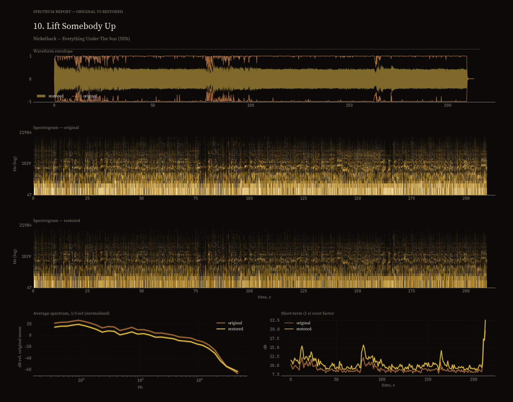
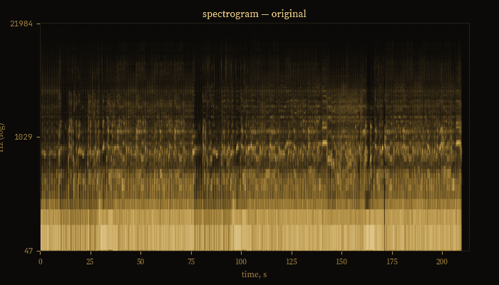
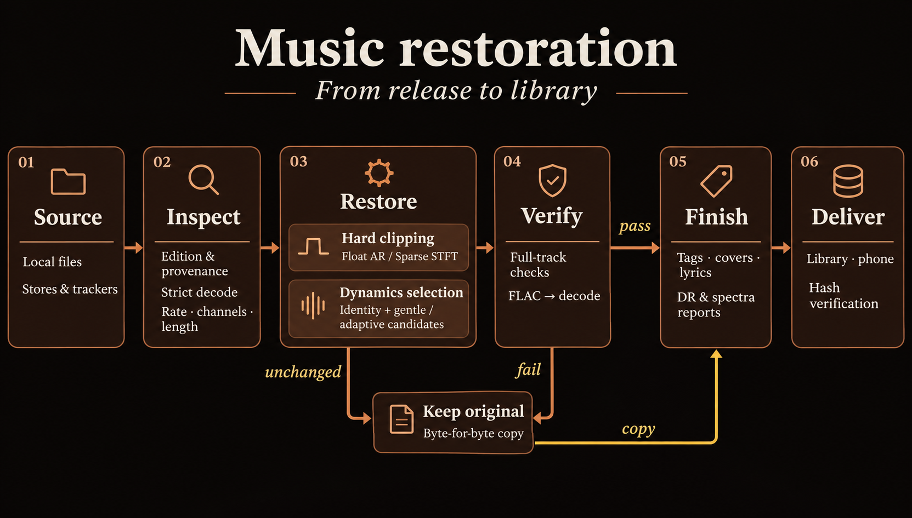

# music-restoration

Agent skills and CLI tools for sourcing, measuring, restoring and delivering a
music library. The preferred runner diagnoses supported hard clipping, chooses
a defect-specific repair or conservative dynamics candidate, and keeps the
original when processing is unsupported or fails its checks.

## See the processing

A report for **“Lift Somebody Up”**: the source in copper, processed output in
gold. Waveform, spectrograms, average spectrum and local dynamics share one page.



The animation flips between the original and processed spectrograms:



Both spectrograms use the same color scale. This is a saved dynamics-processing
example; the current safe runner evaluates each track and may retain its source.

## Current workflow

**Version 2.2 changes the recommended workflow.** Use `restore_safe.py` for new
automatic runs. `restore_per_track.py` remains a legacy comparison tool; its
fixed crest target is not the default quality criterion. No unconditional HPF,
loudness boost or learned EQ curve is applied by the safe path.



[How it works and scientific sources — русский разбор](docs/restoration-method-ru.md)
· [Validation and reproduction](docs/validation/README.md)
· [Setup](docs/setup.md)

## What is established

- The final controlled matrix improved gain-aligned reconstruction on 30
  hard-clipped cases: ten recordings at three degradation levels. All ten clean
  controls were retained unchanged. These are artificial hard-clipping tests,
  not 30 independent recordings or listener preferences.
- On the first seven-recording holdout, the frozen sparse prototype improved
  reconstruction but remained behind precomputed A-SPADE and SS-PEW results.
  Our implementation is independent, not an exact A-SPADE port.
- Better DR or closer summary metrics do not prove better sound. Superiority
  to human remasters is not established by current listening data.
- A FLAC container does not establish lossless ancestry. MP3-derived audio
  stays lossy-derived after processing or conversion to FLAC.

## Quick start

```bash
git clone https://github.com/MyDum-bsu/music-restoration.git
cd music-restoration
python3 -m venv .venv
source .venv/bin/activate
python -m pip install -e ".[dev]"
./install.sh
python3 scripts/doctor.py
```

Python 3.10+ and external audio tools are required. The installer prints package
commands for missing tools, links skills into `~/.agents/skills` and creates a
local workspace config. `doctor` exit 1 means a required check failed; exit 2
means only optional machine-local services are unavailable. Tracker and phone
credentials are needed only for their stages; see [setup](docs/setup.md) and
the skill's local-input guidance.

Symlink installations receive the changed skill when the repository updates.
Copy installations need `./install.sh --copy` again. Preserve locally edited
skill copies before replacing them.

## Restore and inspect

```bash
python3 scripts/audio_measure.py "album/"
python3 scripts/restore_safe.py --src "album/" --out "out/album-candidate"
```

Input is a FLAC track or directory of FLAC tracks; output must be empty. Native
mono/stereo channels and sample rate are preserved. Processed candidates are
encoded as 24-bit FLAC, strictly decoded and checked again. Greater storage bit
depth does not create source information. Other formats can first be decoded
to FLAC with their provenance recorded; multichannel conversion is explicit.

Read **every entry** in `report.json`:

| Status | Meaning |
|---|---|
| `processed_candidate` | Accepted processing and encoded QC; listening remains unevaluated |
| `kept_original` | Byte-for-byte copy; original defects or headroom may remain |
| `qc_fallback_original` | Processing rejected; source copied with reasons recorded |
| `error` | No accepted deliverable; CLI exits nonzero |

Auto checks hard clipping before dynamics classification. `--mode declip`
requests repair only; `--mode dynamics` selects the dynamics branch. Quiet/sparse
and high-DR material normally stays unchanged in auto. See [release-restore](skills/release-restore/SKILL.md)
for threshold overrides and limitations.

After checking statuses, finish tags, covers, lyrics and collection delivery:

```bash
python3 scripts/finish_release.py --restored "out/album-candidate" \
  --source "album/" --dest "collection/album-candidate"
```

Then evaluate the result against its source:

```bash
python3 scripts/evaluate_album.py --src "album/" --restored "out/album-candidate" \
  --out "eval/album-candidate"
```

One command measures both sides with the same instrument, applies a verdict
ladder declared before the data (true-peak ceiling on our output first, then a
DR gap, then click-like jumps; loudness never votes), lifts `report.json`
statuses and renders `REPORT.md` with the systematic shifts and the limits of
the metrics. Which command answers which question:
[docs/evaluation.md](docs/evaluation.md).

Phone delivery is a separate requested stage; verify device-side hashes.
Preserve the original source, provenance and processing report.

## Skills

| Skill | Purpose |
|---|---|
| `music-care` | Routes music requests |
| `release-restore` | Sources, diagnoses, processes or retains, verifies and dresses a release |
| `audio-measure` | DR, LUFS, true peak, clipping and authenticity clues |
| `tracker` | Searches, compares and downloads releases |
| `add-lyrics` | Embeds lyrics into tags |
| `phone-music` | Audits and maintains a phone library |
| `split-flac-album` | Splits image+cue into tagged tracks |

Lossless routes include local downloads/rips, trackers, artist/label stores,
Bandcamp, Qobuz, Presto and CDs. Recording identity, edition and the acquired
file matter more than container labels. Catalog discovery and purchases are
distinct states. See [source selection](skills/release-restore/references/sources.md).

## Limitations and research

Repair targets supported repeated hard-clipping plateaus. Soft limiting,
arbitrary saturation, codec loss and artistic intent remain different problems.
Sparse repair can be slow; whole-track PCM memory grows with duration. Stereo
and album-level perceptual evaluation remain open. Keep originals and failures
visible in batch reports.

`research/` contains reproducible experiments; product modules do not import it.
Historical spectrograms and DR reports are descriptive examples, not proof that
missing frequency content was recovered or a human restorer was surpassed.

```bash
python3 -m pytest tests/ -q
```

Code and skills: MIT, see [LICENSE](LICENSE). Referenced research code and audio
retain their own licenses; no external corpus audio or GPL implementation is
redistributed here.
