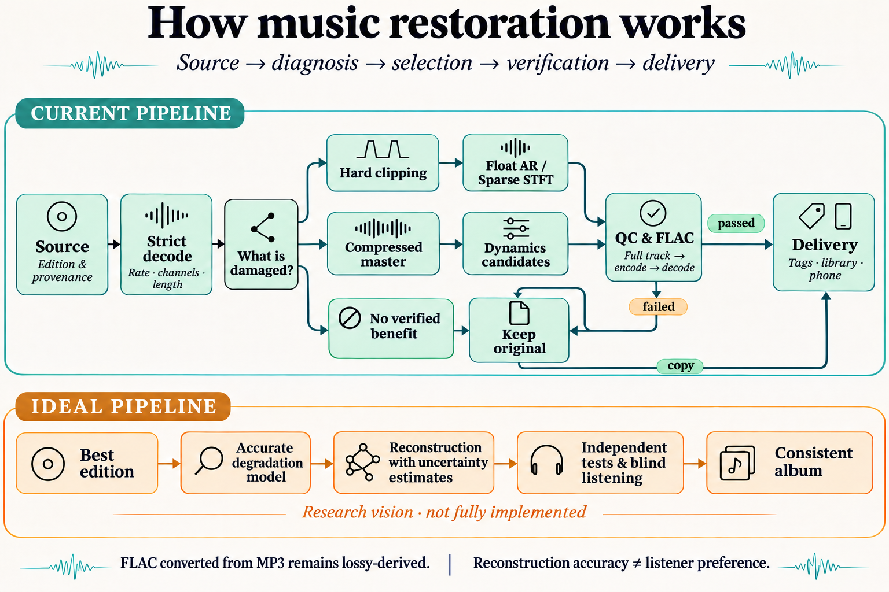

# Как работает реставрация музыки

Обновлённый скилл связывает поиск подходящего издания, диагностику, обработку, контроль файлов и выдачу в коллекцию. Главное изменение DSP: распознаваемый hard clipping получает отдельную реконструкцию, а сохранение исходника стало полноценным решением. Прохождение инженерных проверок ещё не устанавливает приятность звучания.

Схема показывает выбор действий. Низкий DR плотного мастера сам по себе не доказывает повреждение. Ветка динамики проверяет кандидаты относительно исходника и может сохранить его. Доставка на телефон выполняется по запросу с проверкой переданных файлов.

## Какие задачи нужно разделять

| Вопрос | Проверка | Недостаточное свидетельство |
|---|---|---|
| Хорош ли источник? | Точная запись, версия, издание, полученный файл и происхождение | Надпись FLAC или 24/192 |
| Исправлен ли дефект? | Модель повреждения, реконструкция, сравнение с identity | Один рост DR или исчезновение full-scale после ослабления |
| Лучше ли звучит? | Одинаковые фрагменты вслепую при согласованной громкости | Близость сводных чисел к чужому ремастеру |

Подходящий другой мастер может дать больше, чем обработка плохого. FLAC из MP3 остаётся lossy-derived. Реставрация не меняет историю файла; [выбор источников](../skills/release-restore/references/sources.md) предшествует DSP.

## Что изменено

| Прежняя проблема | Изменение | Причина |
|---|---|---|
| При integer-деклиппинге весь float-трек мог стать int16, а HPF терялся | Legacy заменяет только изменённые сэмплы, затем фильтрует; новый ремонт работает во float | Сохранить точность неповреждённой части |
| `abs(-32768)` переполнялся в int16 | Разрядность расширяется до вычисления модуля | Видеть отрицательный full scale |
| Sweep стремился к фиксированному приросту crest без identity | Несколько кандидатов, вариант сохранить источник, проверка полного трека | Не подгонять любую музыку под одно число |
| Высокий DR мог подавлять ремонт клиппинга | Plateau проверяются до классификации динамики | Разделить диагноз и сводный DR |
| AR ограничивался int16-пределом | Float AR либо согласованная sparse-реконструкция допускают вершины выше порога | Не обрезать реконструкцию повторно |
| Верхний PCM-bin пропускал dithered plateau | Объединяются поддержанные соседние bins | Учитывать квантование и небольшой dither |
| Decode мог терпеть ошибки | Строгий decode, формат/длина, повторный decode выхода | Не принимать повреждённый файл |
| Индивидуальные peak caps нарушали LUFS matching | Единая достижимая громкость и измерение после кодирования | Уменьшить громкостную подсказку |
| Метаданные могли раскрыть слепые версии | Исходные теги удаляются | Сохранить слепое сравнение |

Код: [выбор ветки](../rnext/dsp/repair.py), [детектор и sparse](../rnext/dsp/sparse.py), [AR](../rnext/dsp/predictive.py), [динамический отбор](../rnext/dsp/selection.py), [CLI и encoded QC](../scripts/restore_safe.py).

## Текущий алгоритм

### Источник и диагноз

Агент сверяет запись, версию и происхождение. Строго декодирует, проверяет длину, частоту и каналы. Native mono/stereo сохраняются; неявного multichannel downmix нет. Контейнер не доказывает lossless-происхождение.

Детектор hard clipping ищет повторные площадки у положительного и отрицательного экстремумов и избыток массы гистограммы на предельном уровне. До трёх соседних PCM-bins учитывают небольшой dither. После подтверждения уровня в маску включаются и одиночные сэмплы на нём.

Это распознавание формы, а не намерения автора. Можно пропустить меняющийся порог, широкое облако шума или редкие clips. Намеренная цифровая перегрузка может выглядеть так же. Ручной `--clip-threshold` задаёт маску, но не устанавливает правильность диагноза.

### Float AR

Авторегрессия предсказывает сэмпл по предшествующим:

$$
\hat x_n=\sum_{k=1}^{p}a_k x_{n-k}.
$$

Коэффициенты оцениваются по надёжному контексту с небольшой регуляризацией. Проверяются оставленные для валидации строки контекста и согласие предсказаний вперёд/назад. Требуются высокое покрытие маски уверенными предсказаниями и достаточная доля изменённых сэмплов. Иначе используется sparse-ядро.

Это инженерные эвристики: «90% покрытия» не означает «90% вероятности правильной реконструкции». Периодические тоны проверяют полезный частный случай, но не представляют всю полифоническую музыку. Наш AR не является реализацией более общего алгоритма из [работы Mokrý и Rajmic](https://arxiv.org/abs/2410.17790); он остаётся кандидатом будущего сравнения.

### Разреженная реконструкция

Для наблюдения $y$ и реконструкции $z$ ядро фиксирует надёжную часть и не заставляет повреждённые вершины оставаться на clip-пороге:

$$
z_n=y_n\;(n\in R),\quad z_n\ge y_n\;(n\in C_+),\quad z_n\le y_n\;(n\in C_-).
$$

$R$ — незамаскированные сэмплы, $C_+,C_-$ — предполагаемые положительные/отрицательные clips. Между проекциями на ограничения алгоритм оставляет сильные time-frequency коэффициенты, постепенно увеличивая их число. Предположение: подходящий сигнал имеет достаточно компактное представление в выбранном преобразовании.

Наша независимая реализация использует Parseval STFT: окно 4096 при 44.1 kHz, шаг в четверть окна, максимум 160 итераций. Длинные записи обрабатываются перекрывающимися 12-секундными блоками. Положительное взвешенное объединение сохраняет ограничения; надёжные сэмплы дополнительно возвращаются из входа точно. Лимит итераций не означает сходимости или глобального оптимума.

Это связано с analysis sparsity и семейством SPADE, математический разбор которого есть в [S-SPADE Done Right](https://arxiv.org/abs/1809.09847). Наш код не является точным A-SPADE с его параметрами. Внешняя GPL/MATLAB-реализация не включена в MIT-проект.

### Динамика и контроль выхода

Без поддержанного hard clip тихий/sparse, короткий и высокодинамичный материал в auto обычно сохраняется. Для плотного материала identity сравнивается с мягкими flatten/expand-кандидатами на распределённых участках, затем проверяется весь трек. Учитываются block-based TT DR, форма активных спектральных полос, новые скачки и границы. Обязательного HPF и автоматической обученной EQ-кривой нет. Пороги являются safeguards, а не установленными порогами слышимости; это не доказанное обращение неизвестного студийного компрессора.

После ремонта одно ослабление, общее для каналов, при необходимости обеспечивает headroom около −1 dBFS true peak. Надёжная часть проверяется **до** gain. Требуемое дополнительное ослабление более 24 dB отклоняет кандидата; эта граница не является оценкой его вероятности.

Кандидат кодируется в 24-bit FLAC и снова строго декодируется. Проверяются длина, формат, пики и соответствие принятому float-waveform с допуском квантования. При отказе копируется исходный файл. Принятая обработка, исходник, fallback и ошибка имеют разные статусы. Теги, обложки, лирика и запрошенная доставка выполняются после проверки статусов.

## Измеренные результаты

Финальная матрица: десять mono-записей при трёх уровнях искусственного hard clipping и десять чистых контролей. Все 30 повреждённых случаев улучшили реконструкцию, контроли сохранились точно. Это повторно используемый корпус, не 30 независимых произведений.

| Входной SDR, dB | Записей | Медиана выигрыша | Минимум |
|---|---:|---:|---:|
| 7 | 10 | 9.51 dB | 4.84 dB |
| 15 | 10 | 17.84 dB | 6.53 dB |
| 20 | 10 | 18.82 dB | 6.10 dB |

Считается waveform SDR после оптимального скалярного согласования gain, без временного сдвига. Это не DR, не стандартный SI-SDR и не авторский clipped-sample ΔSDR. Медианы описывают выборку, не вероятность выигрыша на любой песне. [Полная таблица и воспроизведение](validation/README.md).

В первой проверке параметры sparse-прототипа выбраны на трёх записях и заморожены до семи других. При известной маске он улучшил все семь: медиана +17.36 dB. Предоставленные результаты A-SPADE сильнее на медианные парные 1.10 dB, SS-PEW — на 3.17 dB. Мы сравнивали готовые аудиофайлы, не исполняли их программы. Источник — [авторская площадка с десятью mono-фрагментами EBU SQAM](https://rajmic.github.io/declipping2020/). Последующая интеграция не является новым независимым holdout.

На двух 20-секундных стереофрагментах локальной коллекции ремонт добавленного hard clipping дал +3.93/+3.00 dB; их чистые контроли сохранены. Эталон здесь — локальный waveform до добавления дефекта, не студийный оригинал. Обработка повреждённого фрагмента заняла около трёх минут. Полная mono-матрица — 7:10.66, max RSS около 382 MiB в данном окружении. FFT-workspace ограничен блоком, полные PCM-массивы растут с длиной файла.

Голосов слушателей пока нет. Подготовленные слепые пакеты с повторами не заменяют проведённого исследования. Сближение DR/crest с версиями Лисного Йожыга/Alias Divas не доказывает лучшего или равного звучания: метрики связаны, peak и band RMS зависят от gain, чужой ремастер не является известным чистым исходником.

## Пределы и идеальный агентный скилл

Даже идеальный алгоритм не может однозначно восстановить любую потерю. После clip на 0.5 значения 0.6 и 0.9 дают одинаковое наблюдение. Без дополнительного знания единственного правильного ответа нет. Музыкальные закономерности помогают выбирать правдоподобное, но не гарантируют историческую точность.

Идеальный агент должен:

1. **Выбрать запись и мастер:** сверить исполнение, edit/remix, издание, длительность, fingerprints и происхождение; предпочесть подходящий неповреждённый источник.
2. **Оценить диагноз:** отделить hard clip, soft limiting, сатурацию, codec loss, шум и намеренный эффект; уметь отказаться от неуверенного диагноза.
3. **Сравнить методы по дефекту:** identity, сильные классические baseline и проверенные модели, с учётом надёжных данных и стоимости вычислений.
4. **Оценить неоднозначность:** находить неустойчивые участки по нескольким правдоподобным решениям. Разброс вариантов сам по себе ещё не является калиброванной уверенностью.
5. **Сохранить музыкальную структуру:** стереосвязь, фазу, транзиенты, хвосты, gapless и относительные уровни песен альбома.
6. **Пройти независимую приёмку:** новые записи/альбомы без утечек, другие жанры/дефекты, распределения ошибок, отказы, ресурсы и слепая оценка артефактов/предпочтения. [ITU-R BS.1116](https://www.itu.int/rec/R-REC-BS.1116-3-201502-I/en) — ориентир формального исследования малых искажений; наш пакет не объявляется соответствующим стандарту.
7. **Выдать проверяемый результат:** hashes, источник, версии кода/параметров, причины выбора, QC, слушательский статус и проверка файла на устройстве назначения.

Исследовательский маршрут — conditioned generative restoration. [VRDMG](https://arxiv.org/abs/2309.06934) изучает diffusion posterior sampling для вокального declipping и расширения полосы. Это кандидат для сравнения, но результат для вокала нельзя автоматически переносить на полный стереомикс. В продукте этих моделей нет. Ансамбль и оценка неопределённости выше — описание желаемой системы, а не выполненная реализация статьи.

Контракт идеального скилла: правильный источник и сохранённый оригинал на входе; явные диагноз, происхождение и критерии приёмки; на выходе — принятый кандидат либо обоснованное сохранение исходника, воспроизводимый отчёт и проверенная доставка. «Не обрабатывать» остаётся допустимым профессиональным решением.

## Что читать

| Материал | Зачем и как связан с проектом |
|---|---|
| [Záviška et al., survey, 2021](https://arxiv.org/abs/2007.07663) | Карта методов, предположений и оценки; основа выбора baseline |
| [Авторские аудиопримеры](https://rajmic.github.io/declipping2020/) | Сравнить методы и уровни; наши метрики пересчитаны отдельно |
| [S-SPADE Done Right](https://arxiv.org/abs/1809.09847) | Analysis/synthesis постановки и ADMM; математический контекст |
| [Crossfading in audio declipping](https://arxiv.org/abs/2104.03074) | Проверка надёжной части и переходов; наше блоковое объединение не объявляется реализацией этой статьи |
| [Regularized autoregressive modeling](https://arxiv.org/abs/2410.17790) | Более общий AR-подход; пока не внедрён |
| [VRDMG](https://arxiv.org/abs/2309.06934) | Diffusion-подход к вокалу; исследовательский кандидат |
| [ITU-R BS.1116](https://www.itu.int/rec/R-REC-BS.1116-3-201502-I/en) | Требования к формальной слуховой приёмке |

Ближайшие точки роста: сильные classic/regularized-AR baseline на новых записях, реальные слушательские оценки, отдельный протокол soft limiting, стерео/альбомные эффекты и ускорение измеренных узких мест. Каждый шаг должен добавлять свидетельства качества, а не только новый модуль обработки.
