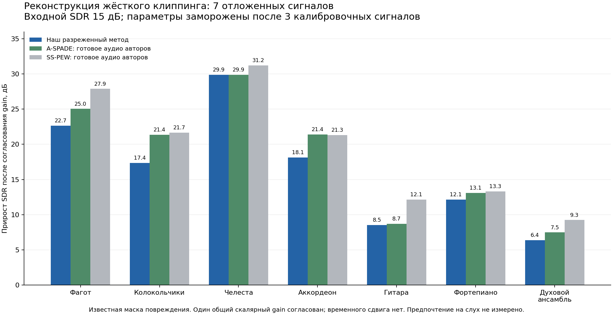

# Controlled declipping validation — 2026-11-09

The final matrix evaluates defect-specific DSP from commit `1c8c34d`.
Publication changes do not alter that DSP. The metric is waveform SDR after
optimal scalar gain alignment, without time shift: neither standard SI-SDR nor
the authors' clipped-sample ΔSDR. Files are paired explicitly and SHA-256 pinned.

## Native-format regression matrix

Ten mono recordings at input SDR 7/15/20 dB, plus ten clean controls:

| Input SDR | Cases | Median gain | Minimum | Maximum |
|---|---:|---:|---:|---:|
| 7 dB | 10 | 9.51 dB | 4.84 dB | 16.24 dB |
| 15 dB | 10 | 17.84 dB | 6.53 dB | 29.92 dB |
| 20 dB | 10 | 18.82 dB | 6.10 dB | 29.14 dB |

All 30 damaged cases improved over identity; all ten clean controls were kept
exactly; errors: zero. Native mono and 44.1 kHz were preserved. See [per-case
results](declipping-matrix.csv). Repeated levels are not independent recordings.
Other production rates, defects and genres need separate evaluation.

The run took 7:10.66, max RSS 390720 KiB, `OPENBLAS_NUM_THREADS=1`; these are
measurements of that machine, not portable speed guarantees. Two additional
20-second stereo excerpts improved by 3.93/3.00 dB after added hard clipping;
clean controls were kept and encoded FLAC checked. Their local pre-degradation
waveforms are experimental references, not studio ground truth. Library audio
is not redistributed.

## First frozen prototype holdout

Three calibration recordings selected the 4096-sample window. Parameters were
frozen before seven other recordings at input SDR 15 dB, with a known mask.
All improved: median +17.36 dB, minimum +6.38 dB. Supplied A-SPADE and SS-PEW
outputs had median paired advantages of 1.10/3.17 dB over our prototype.
Their programs were not executed here. SS-PEW references are original outputs,
not our own reliable-sample postprocess.



[Numeric comparison](clipping-holdout.csv). This figure concerns the prototype,
not later auto-detector integration. Expanded runs reuse the same corpus and
are not a second independent holdout.

## Reproduce

The [authors' site](https://rajmic.github.io/declipping2020/) supplies the audio.
This repository contains [URLs, sizes and hashes](declipping-corpus.json), not
the recordings. After installing dependencies, run from the repository root:

```bash
python3 research/fetch_declipping.py --out data/declipping
OPENBLAS_NUM_THREADS=1 python3 research/bench_declipping.py \
  --manifest data/declipping/benchmark-manifest.json --out out/declipping-validation
```

The downloader verifies existing files without overwriting corrupt caches.
`--cached-only` prepares a manifest without network access. A size/hash mismatch
is an error. The benchmark rejects incorrect degradation levels or reference
format/length, records implementation hashes and writes each result including
errors. Output must be empty. Numerical-library differences can alter this
nonconvex method; identical waveform hashes across platforms are not promised.

No listener ratings were collected. Objective gains and successful QC do not
establish perceptual preference or superiority to human restorers. See the
[method explanation](../restoration-method-ru.md).
